# Simulasi Penggunaan & Galeri SVG Setiap Menu
**Barber Suite v4.2.0 — by Kriakarya 2026**

Folder ini (`simulasi-menu-svg/`) berisi kumpulan file visual **SVG** untuk seluruh menu pada aplikasi **Barber Suite v4.2.0** beserta simulasi singkat alur penggunaannya dari awal hingga akhir operasional harian barbershop.

---

## Daftar File di Dalam Folder Ini

| No | Nama File | Menu / Fungsi |
| :---: | :--- | :--- |
| 0 | [`00-alur-simulasi.svg`](./00-alur-simulasi.svg) | Diagram alur simulasi 5 langkah penggunaan aplikasi dari kasir hingga laporan & CRM |
| 1 | [`01-onboarding.svg`](./01-onboarding.svg) | Menu Persiapan Awal (Onboarding Identitas Toko & Barber Pertama) |
| 2 | [`02-beranda.svg`](./02-beranda.svg) | Menu Beranda (Ringkasan Omzet Hari Ini, 5 Transaksi Terakhir, Pengingat Backup) |
| 3 | [`03-kasir-pos.svg`](./03-kasir-pos.svg) | Menu Kasir Cepat / Fast POS (Barber Chips, Cari Layanan, Urutan Terlaris, Keranjang Bawah) |
| 4 | [`04-checkout-kasir.svg`](./04-checkout-kasir.svg) | Menu Checkout Kasir (Rincian Item, Autocomplete Pelanggan & WA, Metode Bayar, Simpan) |
| 5 | [`05-struk-berhasil.svg`](./05-struk-berhasil.svg) | Menu Transaksi Berhasil (Tombol **Kirim Struk**, Pratinjau Struk Kertas Thermal, Teks Apresiasi) |
| 6 | [`06-pelanggan-crm.svg`](./06-pelanggan-crm.svg) | Menu Pelanggan & CRM (Filter **Belum Kembali >3 mgg** & Tombol **Follow-Up WA**) |
| 7 | [`07-laporan-omzet.svg`](./07-laporan-omzet.svg) | Menu Laporan (Total Omzet, Tunai/Transfer/QRIS, Pendapatan per Barber & Layanan, PDF/CSV) |
| 8 | [`08-menu-lainnya.svg`](./08-menu-lainnya.svg) | Menu Lainnya (Navigasi ke Riwayat Transaksi, Layanan, Barber, Backup & Restore, Pengaturan) |
| 9 | [`09-riwayat-transaksi.svg`](./09-riwayat-transaksi.svg) | Menu Riwayat Transaksi (Pencarian Struk, Filter Periode, dan Status Void) |
| 10 | [`10-kelola-layanan.svg`](./10-kelola-layanan.svg) | Menu Kelola Layanan (Daftar Harga, Durasi Menit, dan Status Aktif) |
| 11 | [`11-kelola-barber.svg`](./11-kelola-barber.svg) | Menu Kelola Barber / Kapster |
| 12 | [`12-backup-restore.svg`](./12-backup-restore.svg) | Menu Backup & Restore Database Lokal (`.json` dengan Checksum SHA-256) |
| 13 | [`13-pengaturan-pin.svg`](./13-pengaturan-pin.svg) | Menu Pengaturan Profil Toko, Footer Struk & Keamanan PIN (4–6 Digit) |
| 14 | [`simulasi-interaktif.html`](./simulasi-interaktif.html) | Simulasi Interaktif Berbasis Browser (Klik antar-menu & jalankan tur simulasi otomatis) |

---

## Ringkasan Visual Alur Simulasi

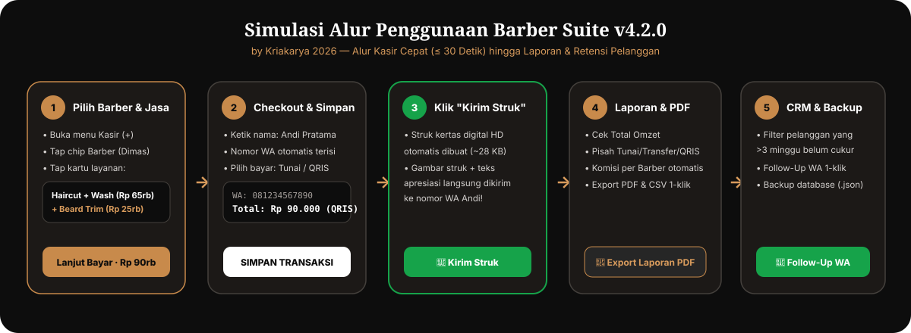

---

## Simulasi Singkat Penggunaan Harian (Step-by-Step)

Berikut adalah skenario nyata penggunaan **Barber Suite v4.2.0** di barbershop **"Gentlemen's Cut Studio"** yang memiliki 2 kapster aktif (**Dimas** dan **Raka**).

---

### Tahap 1: Persiapan Awal Toko (Hanya Sekali Saat Pertama Instal)
1. Saat aplikasi pertama kali dibuka, pemilik toko mengisi:
   - **Nama Barbershop**: `Gentlemen's Cut Studio`
   - **Alamat**: `Jl. Kemang Raya No. 18, Jakarta`
   - **Nomor Telepon/WA**: `0812-8899-7766`
   - **Daftar Barber**: `Dimas` dan `Raka`
2. Ketuk tombol **"Simpan & Mulai Pakai Kasir"**. Sistem otomatis menyiapkan 4 layanan dasar (*Haircut, Haircut + Wash, Shaving, Creambath*).

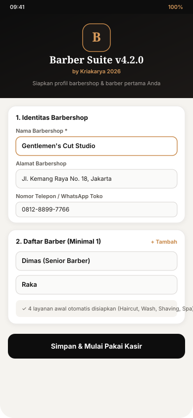

---

### Tahap 2: Memantau Beranda Saat Toko Buka
1. Di halaman **Beranda**, kasir atau owner langsung melihat:
   - **Omzet Hari Ini** secara *real-time* (`Rp 1.450.000` dari `22 transaksi`).
   - Daftar **5 Transaksi Terakhir Hari Ini**.
2. Ketika ada pelanggan selesai potong rambut dan menuju meja kasir, ketuk tombol **"+ Transaksi Baru"** (atau tombol bulat **+** di tengah navigasi bawah).

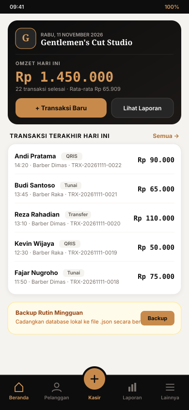

---

### Tahap 3: Mencatat Pesanan di Kasir Cepat ($\le 15$ Detik)
**Skenario**: Pelanggan bernama **Andi Pratama** baru selesai potong rambut + cuci (*Haircut + Wash*) dan merapikan jenggot (*Beard Trim*) dengan barber **Dimas**.
1. **Pilih Barber**: Di bagian atas layar kasir, chip **Dimas** sudah terpilih otomatis (karena aplikasi mengingat barber terakhir).
2. **Pilih Layanan**:
   - Ketuk kartu **Haircut + Wash** (`Rp 65.000`) $\rightarrow$ lencana angka `1` muncul.
   - Ketuk kartu **Beard Trim** (`Rp 25.000`) $\rightarrow$ lencana angka `1` muncul.
3. Bilah bawah otomatis menghitung **2 item · Rp 90.000**. Ketuk **"Lanjut Bayar"**.

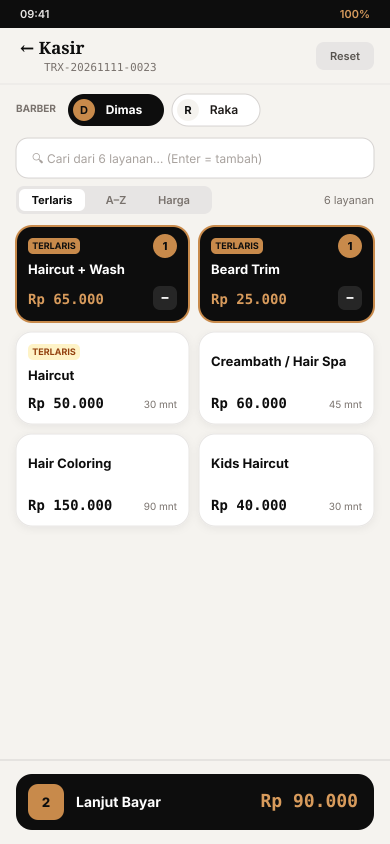

---

### Tahap 4: Checkout & Pemilihan Metode Pembayaran
1. Lembar **Checkout** terbuka:
   - Ketik `Andi Pratama` pada kolom **Nama Pelanggan**. Karena Andi adalah pelanggan lama, nomor WhatsApp-nya (`081234567890`) langsung terisi otomatis.
   - Pada bagian **Pembayaran**, ketuk **QRIS** (tersedia pilihan *Tunai, Transfer, QRIS*).
   - Jika ada promo, buka **Diskon & catatan** untuk mengisi potongan harga (`Rp` atau `%`).
2. Ketuk tombol **"SIMPAN TRANSAKSI"**.

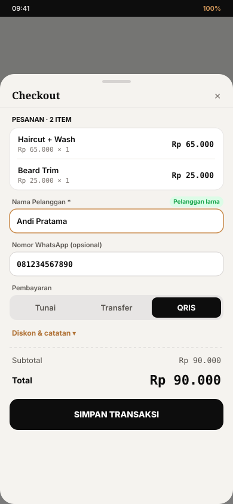

---

### Tahap 5: Kirim Gambar Struk & Apresiasi ke WhatsApp Pelanggan
1. Halaman **Transaksi Berhasil!** menampilkan nomor struk `TRX-20261111-0023` dengan total `Rp 90.000`.
2. Di bawahnya langsung tampil **Pratinjau Struk** bergaya kertas thermal cetak putih bersih (`28 KB`) beserta **Teks Apresiasi Pelanggan**.
3. Kasir cukup mengetuk tombol hijau **"Kirim Struk"**:
   - Aplikasi langsung membuka chat WhatsApp milik **Andi Pratama (`081234567890`)** dengan **file gambar struk sudah terlampir** dan **teks ucapan terima kasih sudah tertulis sebagai caption**.
   - Kasir tinggal menekan tombol *Send* di WhatsApp.

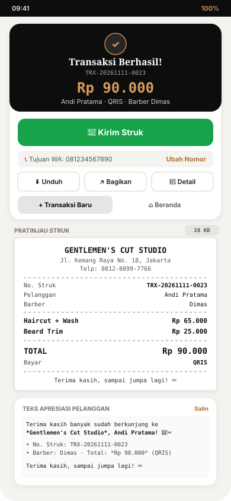

---

### Tahap 6: Follow-Up Pelanggan Lama yang $>3$ Minggu Belum Cukur (CRM)
Saat kursi barbershop sedang lengang di siang hari:
1. Buka menu **Pelanggan** di navigasi bawah, lalu pilih tab **"Belum Kembali (>3 mgg)"**.
2. Aplikasi menampilkan daftar pelanggan yang terakhir kali cukur lebih dari 3 minggu lalu (misalnya **Bagas Saputra** — *4 minggu lalu*).
3. Ketuk tombol hijau **"Follow-Up WA"** pada kartu Bagas. WhatsApp langsung terbuka dengan sapaan personal:
   > *"Halo Bagas Saputra, sudah 4 minggu sejak kunjungan terakhir. Yuk potong rambut lagi di Gentlemen's Cut Studio! ✂️"*

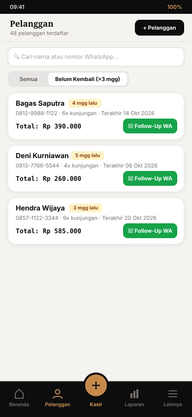

---

### Tahap 7: Rekap Laporan Omzet, Komisi Barber & Ekspor PDF
Saat tutup toko di malam hari atau akhir bulan:
1. Buka menu **Laporan**, pilih periode **Hari Ini**, **Minggu Ini**, atau **Bulan Ini**.
2. Owner langsung melihat:
   - **Total Omzet** (`Rp 18.450.000`) dan **Jumlah Transaksi** (`284`).
   - Rincian uang masuk per metode bayar: **Tunai (`Rp 8.200.000`)**, **Transfer (`Rp 2.850.000`)**, dan **QRIS (`Rp 7.400.000`)**.
   - **Pendapatan per Barber**: **Dimas** (`164 trx · Rp 10.700.000`) dan **Raka** (`120 trx · Rp 7.750.000`) untuk dasar pembagian komisi kapster.
   - **Pendapatan per Layanan** untuk melihat layanan paling menguntungkan.
3. Ketuk tombol **"PDF"** di kanan atas untuk mengunduh atau membagikan laporan resmi berformat PDF, atau **"CSV"** untuk Excel.

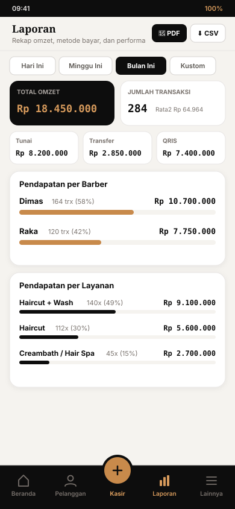

---

### Tahap 8: Pengelolaan Toko, Riwayat Void, Backup Data & Keamanan PIN
Melalui tab **Lainnya** di pojok kanan bawah, owner dapat mengakses:
1. **Menu Lainnya** ([`08-menu-lainnya.svg`](./08-menu-lainnya.svg)): Pusat pintasan manajemen toko.
2. **Riwayat Transaksi** ([`09-riwayat-transaksi.svg`](./09-riwayat-transaksi.svg)): Mencari struk lama atau membatalkan transaksi salah input (**Void**) dengan alasan wajib.
3. **Kelola Layanan** ([`10-kelola-layanan.svg`](./10-kelola-layanan.svg)) & **Kelola Barber** ([`11-kelola-barber.svg`](./11-kelola-barber.svg)): Mengatur harga layanan dan daftar kapster aktif.
4. **Backup & Restore** ([`12-backup-restore.svg`](./12-backup-restore.svg)): Mengekspor seluruh database ke file `.json` ber-checksum `SHA-256`.
5. **Pengaturan & Keamanan PIN** ([`13-pengaturan-pin.svg`](./13-pengaturan-pin.svg)): Mengatur logo/profil toko dan mengaktifkan kunci PIN 4–6 digit (*auto-lock*).

| Menu Lainnya | Riwayat Transaksi | Kelola Layanan |
| :---: | :---: | :---: |
| 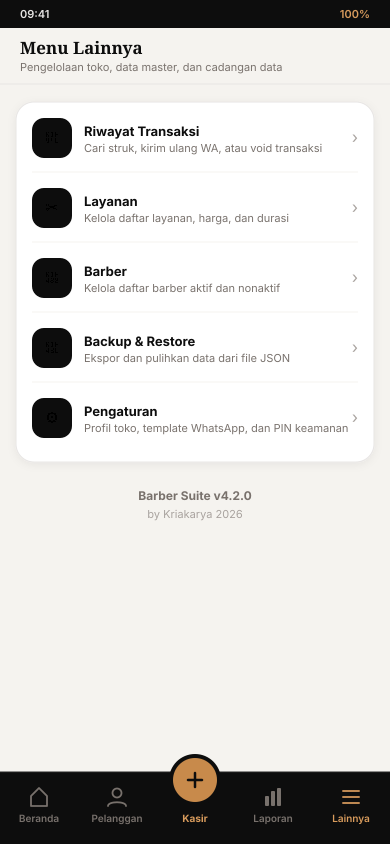 | 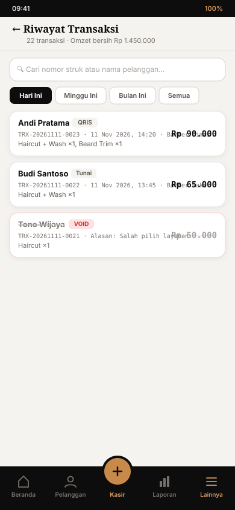 | 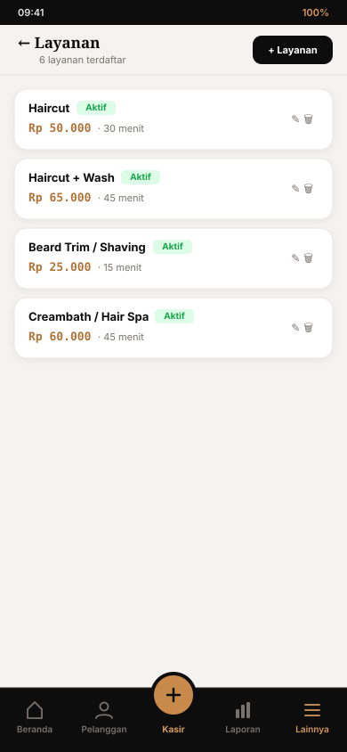 |

| Kelola Barber | Backup & Restore | Pengaturan & PIN |
| :---: | :---: | :---: |
| 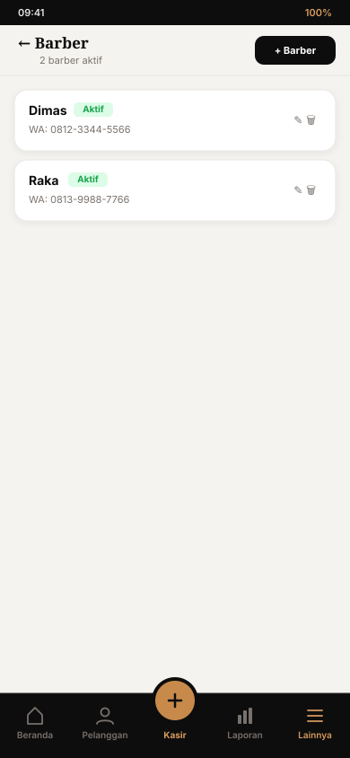 | 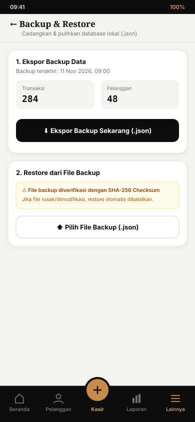 | 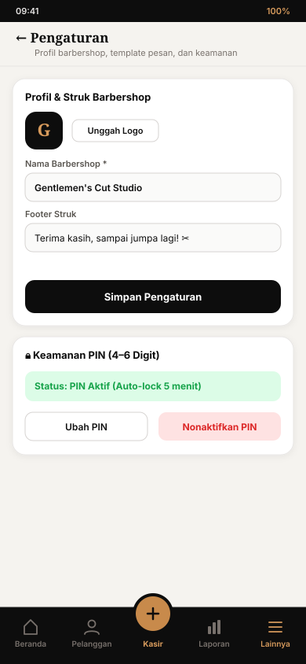 |

